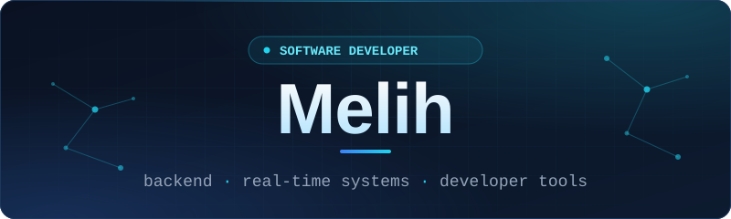

[🇹🇷 Türkçe](README.md) | [🇬🇧 English](README.en.md)

  <b>I build backend systems, real-time applications and developer tools.</b> 
  Currently looking for software development internship opportunities.

## About Me

The part of software development I enjoy most is the part users never see but everything depends on: data that stays consistent under concurrent requests, sessions that pick up where they left off after a dropped connection, and permissions that are actually enforced on the server.

- **Backend systems:** REST APIs with NestJS, Spring Boot and FastAPI; transactions, constraints and locking strategies in PostgreSQL
- **Real-time applications:** multi-user, reconnect-safe experiences with WebSockets, Socket.IO and Yjs (CRDT)
- **Developer tools:** a local tool for searching codebases and an Obsidian plugin that automates a learning workflow
- **How I work:** testing behavior against real dependencies (Testcontainers, Playwright) and documenting decisions and limitations openly

I also use AI-assisted tools in my development process; before I call a project done, I make a point of verifying it with tests and writing down its limitations openly.

## Featured Projects

### [SyncNotes](https://github.com/melihuur1/syncnotes)

**Real-time collaborative notes — Google-Docs-style co-editing built on a CRDT**

Several people edit the same note at once, see each other's cursors and keep working offline; when they reconnect, their changes merge cleanly.

- Lossless concurrent editing with **Yjs CRDT + Hocuspocus**; two collaboration servers behind nginx, kept in sync through Redis fan-out
- Permissions are enforced on the server **even on WebSocket sessions that are already open**: a revoked user's connection is closed instantly, and even if that event is lost, access ends within 5 seconds
- Offline editing with IndexedDB, version history with one-click restore; refresh-token rotation, CSRF protection and Argon2id
- 119 tests with Jest, Vitest and Playwright — including Redis outages, restarts and offline merges

`TypeScript` `NestJS` `Hocuspocus` `Yjs` `React` `Tiptap` `Prisma` `PostgreSQL` `Redis` `Docker`

**[Source code](https://github.com/melihuur1/syncnotes)** · [Architecture notes](https://github.com/melihuur1/syncnotes/blob/main/docs/architecture.md)

### [StockGuard](https://github.com/melihuur1/stockguard)

**Inventory management and a concurrent reservation engine that cannot oversell**

If one unit is left and 100 customers reserve it at the same moment, exactly one must succeed — on any number of application instances, even if an instance crashes halfway through.

- All coordination lives in PostgreSQL: a conditional `UPDATE ... WHERE available >= q`, `CHECK` constraints and triggers; no JVM locks or shared memory
- Idempotency keys (`INSERT ... ON CONFLICT DO NOTHING`) and safe expiry sweeps with `FOR UPDATE SKIP LOCKED`
- A simulated race of 1,000 concurrent requests for 100 units across two instances: **100 successful reservations, 0 oversold**
- Integration tests on real PostgreSQL via Testcontainers, plus `kill -9` crash scenarios; when each safeguard was removed in turn, the tests caught all 16 removals

`Java 21` `Spring Boot` `Spring Security` `JPA / Hibernate` `PostgreSQL` `Flyway` `Testcontainers` `Docker`

**[Source code](https://github.com/melihuur1/stockguard)** · [Concurrency design](https://github.com/melihuur1/stockguard/blob/main/docs/concurrency.md)

### [RepoMind AI](https://github.com/melihuur1/repomind-ai)

**A local tool that finds where and how something is done in a codebase, and shows the exact lines that do it**

It indexes a GitHub repository locally and lets you browse, search and question it in Turkish or English. Every result is a real range of lines, pinned to the Git commit it came from. It is a local web application for one person on one machine.

- Syntax-aware chunking with Tree-sitter (Java, TypeScript, JavaScript), plus structural splitting for SQL and YAML
- Hybrid search: BM25 keyword search and pgvector semantic search, fused with Reciprocal Rank Fusion; Turkish questions are translated locally
- Analyzed repositories are treated as untrusted input: code is never executed, and pattern-based filters keep secrets out of the index
- **Experimental AI analysis:** a local LLM (`qwen2.5:7b` on Ollama) chooses among the lines found. It is not reliable — in the last measurement it pointed at the right source for 8 of 16 questions, and at a wrong one for 4

`Python` `FastAPI` `Tree-sitter` `PostgreSQL + pgvector` `ONNX Runtime` `Ollama` `React` `pytest` `Playwright`

**[Source code](https://github.com/melihuur1/repomind-ai)** · [Evaluation results](https://github.com/melihuur1/repomind-ai/blob/main/docs/evaluation.md)

### [WatchVenn](https://github.com/melihuur1/watchvenn)

**A real-time group movie picker that ends the "what should we watch?" argument in about a minute**

Someone creates a temporary room and shares the link; everyone votes *Evet* (yes), *Fark etmez* (don't mind) or *Veto* on a few movies, and the group gets the top three movies nobody objects to, each with a reason. No accounts, no install.

- The server owns all state and broadcasts a full room snapshot over Socket.IO after every accepted change
- Reconnect-safe client: nothing is sent until the rejoin is acknowledged and a fresh snapshot has arrived
- The voting algorithm is one pure function (`computeResults`): veto elimination, deterministic ranking and tie rules
- 146 Vitest tests (including integration through real socket.io-client connections); keyboard support, `aria-live` and WCAG AA contrast checks

`TypeScript` `React` `Vite` `Tailwind CSS` `Node.js` `Express` `Socket.IO` `Vitest` `Render`

**[Source code](https://github.com/melihuur1/watchvenn)** · **[Live demo](https://watchvenn.onrender.com)**

The demo runs on Render's free tier: after a quiet period, the first visit can take up to about a minute while the service wakes up. The interface is in Turkish.

### [PhraseVault](https://github.com/melihuur1/phrasevault)

**An Obsidian plugin that turns screenshots of English text into numbered, AI-annotated phrase notes**

You paste a screenshot of a subtitle or an article; Claude suggests the expressions worth learning, with Turkish explanations, and after you review and edit them, each one is saved as a numbered note.

- Structured JSON output from the Anthropic API, with schema validation and a check that each quoted expression really appears in the source sentence
- Safe vault writes: notes are only ever created, `INDEX.md` is only appended to, and numbers are never reused
- Estimated cost per analysis from the token usage in the API response, stored as integer picodollars so totals don't drift
- A pure TypeScript core independent of Obsidian and a `VaultPort` abstraction keep it testable; network access is fully blocked in the test suite

`TypeScript` `Obsidian API` `Anthropic SDK` `esbuild` `Vitest` `GitHub Actions`

**[Source code](https://github.com/melihuur1/phrasevault)**

### [AraçKarnesi](https://github.com/melihuur1/arackarnesi)

**A service-verified digital maintenance logbook for vehicle owners and service shops**

Maintenance history lives in one place, service shops get time-limited access, and when the vehicle is sold, its history can be proven with a single link. The interface is in Turkish.

- "Service-verified" records entered by the shop cannot be modified or deleted by the vehicle owner
- Scoped, time-limited access grants for service shops; access is re-evaluated on every request, and users without access get a 404 (existence hiding)
- A time-limited, read-only share link for used-car buyers: costs and personal information are hidden and the VIN is masked
- Maintenance reminders, mileage-inconsistency detection and spending analysis; 168 tests and CI with a Docker smoke test

`TypeScript` `NestJS` `Prisma` `PostgreSQL` `React` `TanStack Query` `Tailwind CSS` `Docker` `nginx`

**[Source code](https://github.com/melihuur1/arackarnesi)** · [Architecture notes (in Turkish)](https://github.com/melihuur1/arackarnesi/blob/main/docs/architecture.md)

## Tech Stack

<table>
  <tr>
    <td><b>Languages</b></td>
    <td>
      
      
      
      
      
    </td>
  </tr>
  <tr>
    <td><b>Backend</b></td>
    <td>
      
      
      
      
      
      
      
    </td>
  </tr>
  <tr>
    <td><b>Real-time</b></td>
    <td>
      
      
      
      
    </td>
  </tr>
  <tr>
    <td><b>Frontend</b></td>
    <td>
      
      
      
      
      
      
      
    </td>
  </tr>
  <tr>
    <td><b>Data</b></td>
    <td>
      
      
      
      
      
      
    </td>
  </tr>
  <tr>
    <td><b>AI and search</b></td>
    <td>
      
      
      
      
    </td>
  </tr>
  <tr>
    <td><b>Testing</b></td>
    <td>
      
      
      
      
      
      
      
    </td>
  </tr>
  <tr>
    <td><b>DevOps and tools</b></td>
    <td>
      
      
      
      
      
      
      
    </td>
  </tr>
</table>

## LeetCode

  <picture>
    <source media="(prefers-color-scheme: dark)" srcset="https://leetcard.jacoblin.cool/melih411848?theme=dark&amp;ext=activity" />
    
  </picture>

 

  
    <a href="https://github.com/melihuur1/syncnotes">SyncNotes</a> ·
    <a href="https://github.com/melihuur1/stockguard">StockGuard</a> ·
    <a href="https://github.com/melihuur1/repomind-ai">RepoMind AI</a> ·
    <a href="https://github.com/melihuur1/watchvenn">WatchVenn</a> ·
    <a href="https://github.com/melihuur1/phrasevault">PhraseVault</a> ·
    <a href="https://github.com/melihuur1/arackarnesi">AraçKarnesi</a>
     
    <a href="https://github.com/melihuur1?tab=repositories">All repositories</a>
  

