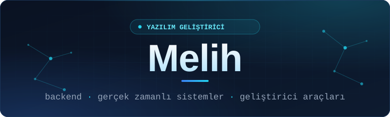

[🇹🇷 Türkçe](README.md) | [🇬🇧 English](README.en.md)

  <b>Backend sistemleri, gerçek zamanlı uygulamalar ve geliştirici araçları üzerine çalışıyorum.</b> 
  Şu anda yazılım geliştirme alanında staj fırsatları arıyorum.

## Hakkımda

Yazılım geliştirmede en çok ilgimi çeken taraf, kullanıcının doğrudan görmediği ama her şeyin ona bağlı olduğu kısım: eşzamanlı isteklerde veri tutarlılığı, kopan bağlantıdan sonra kaldığı yerden devam eden oturumlar ve sunucuda gerçekten uygulanan yetkiler.

- **Backend sistemleri:** NestJS, Spring Boot ve FastAPI ile REST API'ler; PostgreSQL'de transaction, kısıt (constraint) ve kilitleme stratejileri
- **Gerçek zamanlı uygulamalar:** WebSocket, Socket.IO ve Yjs (CRDT) ile çok kullanıcılı, yeniden bağlanmaya dayanıklı deneyimler
- **Geliştirici araçları:** kod tabanlarında arama yapan yerel bir araç ve öğrenme iş akışını otomatikleştiren bir Obsidian eklentisi
- **Çalışma biçimim:** davranışı gerçek bağımlılıklarla test etmek (Testcontainers, Playwright), kararları ve sınırlamaları açıkça belgelemek

Geliştirme sürecimde yapay zekâ destekli araçlardan da yararlanıyorum; bir projeyi bitmiş saymadan önce testlerle doğrulamaya ve sınırlamalarını açıkça yazmaya önem veriyorum.

## Öne Çıkan Projeler

### [SyncNotes](https://github.com/melihuur1/syncnotes)

**Gerçek zamanlı ortak not uygulaması — CRDT üzerine kurulu, Google Docs tarzı eşzamanlı düzenleme**

Birden fazla kişi aynı notu aynı anda düzenler, birbirinin imlecini görür ve çevrimdışıyken çalışmaya devam eder; bağlantı geri geldiğinde değişiklikler sorunsuzca birleşir.

- **Yjs CRDT + Hocuspocus** ile kayıpsız eşzamanlı düzenleme; nginx arkasındaki iki collaboration sunucusu Redis fan-out ile senkron kalır
- Yetkiler **açık WebSocket oturumlarında bile** sunucuda uygulanır: yetkisi kaldırılan kullanıcının bağlantısı anında kapatılır, olay kaybolsa bile erişim en geç 5 sn içinde kesilir
- IndexedDB ile çevrimdışı düzenleme, sürüm geçmişi ve tek tıkla geri yükleme; refresh token rotasyonu, CSRF koruması ve Argon2id
- Jest, Vitest ve Playwright ile 119 test — Redis kesintisi, yeniden başlatma ve çevrimdışı birleştirme senaryoları dahil

`TypeScript` `NestJS` `Hocuspocus` `Yjs` `React` `Tiptap` `Prisma` `PostgreSQL` `Redis` `Docker`

**[Kaynak kod](https://github.com/melihuur1/syncnotes)** · [Mimari dokümanı](https://github.com/melihuur1/syncnotes/blob/main/docs/architecture.md)

### [StockGuard](https://github.com/melihuur1/stockguard)

**Stok yönetimi ve fazla satış (overselling) yapamayan eşzamanlı bir rezervasyon motoru**

Elde tek bir birim kalmışken 100 müşteri aynı anda rezervasyon yaparsa tam olarak biri başarılı olmalı — uygulama kaç örnekte çalışırsa çalışsın ve bir örnek işin ortasında çökse bile.

- Tüm koordinasyon PostgreSQL'de: koşullu `UPDATE ... WHERE available >= q`, `CHECK` kısıtları ve trigger'lar; JVM kilidi ya da paylaşılan bellek yok
- Idempotency anahtarları (`INSERT ... ON CONFLICT DO NOTHING`) ve `FOR UPDATE SKIP LOCKED` ile güvenli süre aşımı taraması
- İki uygulama örneğine karşı 1000 eşzamanlı istekle yapılan simülasyon (100 birim stok): **100 başarılı rezervasyon, 0 fazla satış**
- Testcontainers ile gerçek PostgreSQL üzerinde entegrasyon testleri ve `kill -9` ile çökme senaryoları; her güvenlik önlemi koddan tek tek kaldırılarak denendi: testler 16 durumun tamamını yakaladı

`Java 21` `Spring Boot` `Spring Security` `JPA / Hibernate` `PostgreSQL` `Flyway` `Testcontainers` `Docker`

**[Kaynak kod](https://github.com/melihuur1/stockguard)** · [Eşzamanlılık tasarımı](https://github.com/melihuur1/stockguard/blob/main/docs/concurrency.md)

### [RepoMind AI](https://github.com/melihuur1/repomind-ai)

**Bir kod tabanında bir işin nerede ve nasıl yapıldığını bulan, sonucu birebir satırlarla gösteren yerel araç**

Bir GitHub deposunu yerel olarak indeksler; depoyu gezmeyi, içinde arama yapmayı ve Türkçe ya da İngilizce soru sormayı sağlar. Her sonuç, bir Git commit'ine sabitlenmiş gerçek bir satır aralığıdır. Tek bir makinede, tek bir kişi için çalışan yerel bir web uygulamasıdır.

- Tree-sitter ile söz dizimine duyarlı parçalama (Java, TypeScript, JavaScript); SQL ve YAML için yapısal bölme
- Hibrit arama: BM25 anahtar kelime araması ile pgvector anlamsal araması Reciprocal Rank Fusion ile birleştirilir; Türkçe sorular yerel olarak çevrilir
- Analiz edilen depolar güvenilmeyen girdi olarak ele alınır: kod asla çalıştırılmaz, gizli anahtarlar desen tabanlı filtrelerle indeks dışında tutulur
- **Deneysel yapay zekâ analizi:** yerel bir LLM (Ollama üzerinde `qwen2.5:7b`) bulunan satırlar arasından seçim yapar. Güvenilir değildir — son ölçümde 16 sorunun 8'inde doğru, 4'ünde yanlış kaynağı gösterdi

`Python` `FastAPI` `Tree-sitter` `PostgreSQL + pgvector` `ONNX Runtime` `Ollama` `React` `pytest` `Playwright`

**[Kaynak kod](https://github.com/melihuur1/repomind-ai)** · [Değerlendirme sonuçları](https://github.com/melihuur1/repomind-ai/blob/main/docs/evaluation.md)

### [WatchVenn](https://github.com/melihuur1/watchvenn)

**"Ne izlesek?" tartışmasını yaklaşık bir dakikada bitiren gerçek zamanlı grup film seçimi uygulaması**

Biri geçici bir oda oluşturup linki paylaşır; herkes birkaç film için *Evet*, *Fark etmez* ya da *Veto* der ve grup, kimsenin itiraz etmediği en iyi üç filmi gerekçesiyle görür. Hesap yok, kurulum yok.

- Tüm durum sunucuda tutulur; kabul edilen her değişiklikten sonra odanın tam anlık görüntüsü (snapshot) Socket.IO ile yayınlanır
- Yeniden bağlanmaya dayanıklı istemci: yeniden katılım onaylanıp güncel snapshot gelmeden hiçbir eylem gönderilmez
- Oylama algoritması saf bir fonksiyon (`computeResults`): veto ile eleme, deterministik sıralama ve beraberlik kuralları
- 146 Vitest testi (gerçek socket.io-client bağlantılarıyla entegrasyon dahil); klavye desteği, `aria-live` ve WCAG AA kontrast kontrolleri

`TypeScript` `React` `Vite` `Tailwind CSS` `Node.js` `Express` `Socket.IO` `Vitest` `Render`

**[Kaynak kod](https://github.com/melihuur1/watchvenn)** · **[Canlı demo](https://watchvenn.onrender.com)**

Demo, Render'ın ücretsiz katmanında çalışır; bir süre ziyaret almadıktan sonraki ilk açılış bir dakikayı bulabilir.

### [PhraseVault](https://github.com/melihuur1/phrasevault)

**İngilizce metinlerin ekran görüntülerini yapay zekâ ile açıklanmış, numaralı ifade notlarına dönüştüren Obsidian eklentisi**

Bir altyazının ya da makalenin ekran görüntüsünü yapıştırırsınız; Claude öğrenmeye değer ifadeleri Türkçe açıklamalarla önerir, siz inceleyip düzenledikten sonra her biri numaralı bir not olarak kaydedilir.

- Anthropic API ile yapılandırılmış JSON çıktı; şema doğrulaması ve alıntılanan ifadenin kaynak cümlede gerçekten geçip geçmediği kontrolü
- Vault'a güvenli yazma: notlar yalnızca oluşturulur, `INDEX.md` yalnızca sona eklenir, numaralar asla yeniden kullanılmaz
- API yanıtındaki token kullanımından analiz başına tahmini maliyet; tutarlar kaymasın diye tamsayı pikodolar olarak saklanır
- Obsidian'dan bağımsız saf TypeScript çekirdeği ve `VaultPort` soyutlaması ile test edilebilir yapı; test ortamında ağ erişimi tamamen engellenir

`TypeScript` `Obsidian API` `Anthropic SDK` `esbuild` `Vitest` `GitHub Actions`

**[Kaynak kod](https://github.com/melihuur1/phrasevault)**

### [AraçKarnesi](https://github.com/melihuur1/arackarnesi)

**Araç sahipleri ve servisler için servis onaylı dijital bakım karnesi**

Bakım geçmişi tek yerde tutulur, servise süreli yetki verilir ve araç satılırken geçmişi tek bir linkle kanıtlanır.

- Servisin girdiği "servis onaylı" kayıtlar araç sahibi tarafından değiştirilemez ya da silinemez
- Servislere kapsamı ve süresi sınırlı erişim yetkisi; yetki her istekte yeniden değerlendirilir, erişimi olmayana 404 döner (varlık gizleme)
- İkinci el alıcı için süreli, salt okunur paylaşım linki: maliyetler ve kişisel bilgiler gizlenir, VIN maskelenir
- Bakım hatırlatmaları, kilometre tutarsızlığı tespiti ve harcama analizi; 168 test ve Docker smoke testi içeren CI

`TypeScript` `NestJS` `Prisma` `PostgreSQL` `React` `TanStack Query` `Tailwind CSS` `Docker` `nginx`

**[Kaynak kod](https://github.com/melihuur1/arackarnesi)** · [Mimari dokümanı](https://github.com/melihuur1/arackarnesi/blob/main/docs/architecture.md)

## Teknolojiler

<table>
  <tr>
    <td><b>Diller</b></td>
    <td>
      
      
      
      
      
    </td>
  </tr>
  <tr>
    <td><b>Backend</b></td>
    <td>
      
      
      
      
      
      
      
    </td>
  </tr>
  <tr>
    <td><b>Gerçek zamanlı</b></td>
    <td>
      
      
      
      
    </td>
  </tr>
  <tr>
    <td><b>Frontend</b></td>
    <td>
      
      
      
      
      
      
      
    </td>
  </tr>
  <tr>
    <td><b>Veri</b></td>
    <td>
      
      
      
      
      
      
    </td>
  </tr>
  <tr>
    <td><b>Yapay zekâ ve arama</b></td>
    <td>
      
      
      
      
    </td>
  </tr>
  <tr>
    <td><b>Test</b></td>
    <td>
      
      
      
      
      
      
      
    </td>
  </tr>
  <tr>
    <td><b>DevOps ve araçlar</b></td>
    <td>
      
      
      
      
      
      
      
    </td>
  </tr>
</table>

## LeetCode

  <picture>
    <source media="(prefers-color-scheme: dark)" srcset="https://leetcard.jacoblin.cool/melih411848?theme=dark&amp;ext=activity" />
    
  </picture>

 

  
    <a href="https://github.com/melihuur1/syncnotes">SyncNotes</a> ·
    <a href="https://github.com/melihuur1/stockguard">StockGuard</a> ·
    <a href="https://github.com/melihuur1/repomind-ai">RepoMind AI</a> ·
    <a href="https://github.com/melihuur1/watchvenn">WatchVenn</a> ·
    <a href="https://github.com/melihuur1/phrasevault">PhraseVault</a> ·
    <a href="https://github.com/melihuur1/arackarnesi">AraçKarnesi</a>
     
    <a href="https://github.com/melihuur1?tab=repositories">Tüm depolar</a>
  

